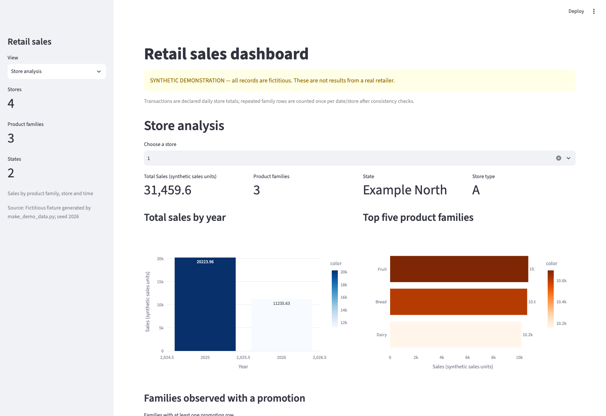
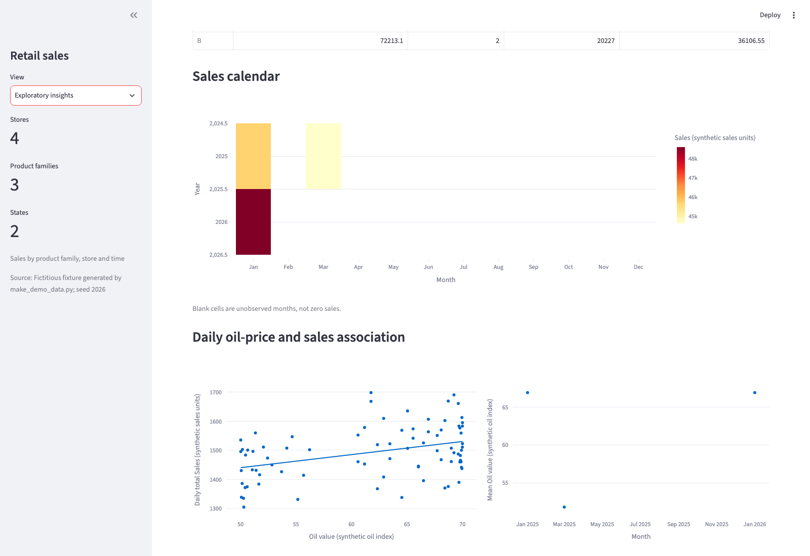

# Retail sales dashboard

A Streamlit dashboard for exploring sales across shops, product families and
time. I built it for a Data Visualisation final project, using pandas for the
data preparation and Plotly for the charts. The included example is **entirely
synthetic**; its figures do not describe a real retailer.

[Run locally](#how-to-run) · [Dashboard views](#dashboard-views) · [Code](#repository-structure) · [Data and limits](#data-and-limits)



The Store analysis view compares the observed sales for one shop. The screenshot
shows the top of the page; promotion information continues below it.

## How to run

Use Python 3.12. From the project folder on macOS or Linux:

```bash
python3.12 -m venv .venv
source .venv/bin/activate
python -m pip install --upgrade pip
python -m pip install -r requirements.txt
python -m streamlit run app.py
```

On Windows, activate with `.venv\Scripts\activate`. Open the local URL printed
by Streamlit. The bundled CSV and metadata are loaded by default, so no account
or data download is needed.

## Dashboard views

| View | What it shows |
| --- | --- |
| Global overview | Sales counts and rankings, promotion rows and seasonal means. |
| Store analysis | Yearly totals and leading product families for a selected shop. |
| State analysis | Shop and family rankings, plus transaction totals when their grain is declared. |
| Exploratory insights | Monthly comparisons, a calendar heatmap, shop types and sales/oil associations. |



Blank calendar cells mean there are no observations for those months. The
scatter and optional OLS line describe an association, not a causal effect.
[More screenshots and reproduction steps](docs/screenshots.md) cover the other
views.

## Repository structure

Start with `app.py` to follow the interface, or `data_utils.py` for the data rules.

```text
retail-sales-dashboard/
├── app.py              # The four Streamlit views and Plotly charts
├── data_utils.py       # Input validation, aggregation and coverage checks
├── make_demo_data.py   # Generator for the synthetic files; running it replaces them
├── requirements.txt
├── data/
│   ├── README.md       # Input contract
│   ├── synthetic_sales.csv
│   └── synthetic_metadata.json
├── tests/              # Data checks and Streamlit AppTest interactions
└── docs/
    ├── screenshots.md  # Screenshots and steps for reproducing the views
    └── images/         # Dashboard screenshots
```

## Data and limits

The example has 1,116 fictitious rows: four shops, three product families and
93 observed dates across January/March 2025 and January 2026. Most months and
some oil observations are deliberately absent.

- Totals cover observed dates only. Seasonal means are per store–family–day row,
  not total daily company sales. `family` means product family, not SKU.
- Percentage changes require comparable months and shop/family coverage with a
  positive baseline. Coverage checks cannot establish whether every real sale
  was captured.
- Units come from metadata; no currency is assumed. Transaction totals are hidden
  unless their grain is declared. Promotion rows need not contain only sales of
  promoted items.
- The original remote data is not included. Its source, redistribution terms,
  units and transaction grain still need confirmation before a real-data run.

For authorised local data, see the [input contract](data/README.md) and set
`RETAIL_DATA_PATH` and `RETAIL_METADATA_PATH` before launching Streamlit.

## Tests

```bash
python -m unittest discover -s tests -v
```

Tests cover validation, aggregation and AppTest interactions. AppTest does not
check browser appearance; the screenshots show desktop views, not mobile layouts.

Individual coursework for Data Visualisation, iMAT, ICAI, Universidad Pontificia
Comillas, 2026.
