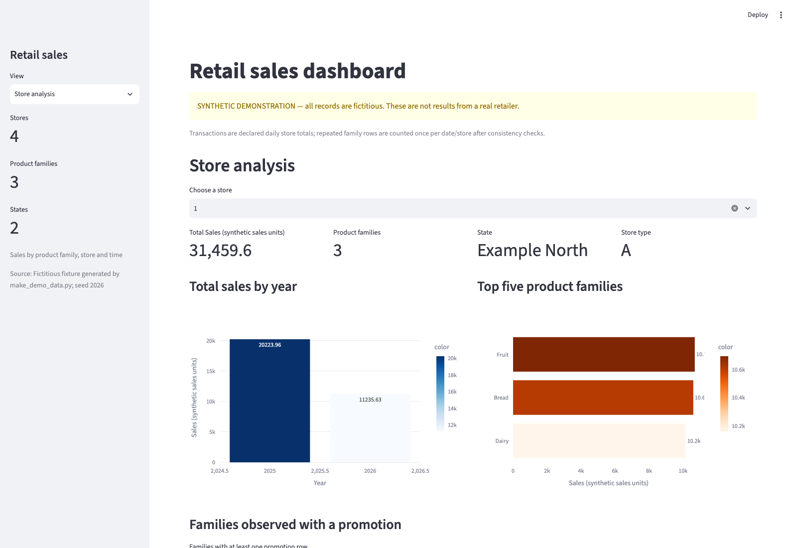
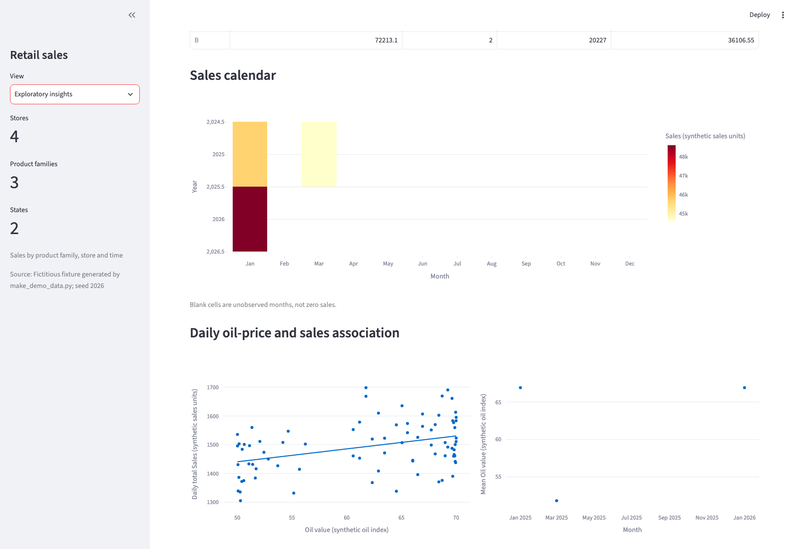

# Retail sales dashboard

My Data Visualisation project uses Streamlit and Plotly to explore retail sales
by product family, shop, state and time. It also compares promotion groups and
daily sales with an oil-price series. The application starts with a clearly
labelled **synthetic example**; no displayed figure describes a real retailer.



**Store analysis → store 1**, captured in Chromium on macOS on 26 October 2026.
This shows the upper section of the live application with the bundled fictitious
data. All displayed units and totals are synthetic; the promotion section
continues below the captured area.

## Run

Tested with Python 3.12.2 on macOS and Python 3.12.14, using pip 26.2.2 and
Streamlit 1.66.1. From this folder:

```bash
python -m venv .venv
source .venv/bin/activate
python -m pip install --upgrade pip
python -m pip install -r requirements.txt
python -m streamlit run app.py
```

On Windows, activate with `.venv\Scripts\activate`. Open the local URL printed
by Streamlit. No account or data download is required. `statsmodels` is included
because the exploratory view uses Plotly's OLS trend line.

The fixture contains 1,116 fictitious rows: four shops, three product families
and 93 observed dates across January/March 2025 and January 2026. It intentionally
omits most months and some oil observations. Regenerate it with
`python make_demo_data.py`; this replaces the bundled synthetic files.

## Four views

1. **Global overview:** store/family/state counts, rankings, promotion rows and
   weekday/week/month mean sales. Means are per observed store–family–day row,
   not total company sales per day.
2. **Store analysis:** yearly sales, leading families and families appearing on
   promotion rows for a selected shop.
3. **State analysis:** store rankings, family sales and annual transaction totals
   where transaction grain is documented.
4. **Exploratory insights:** promotion-group comparisons, monthly totals,
   same-month changes, a year/month heatmap, store types and a daily sales/oil
   scatter with an OLS line where defined.

The available output is the runnable synthetic dashboard, not reproduced
real-company KPIs. All four views and their selectors passed Streamlit AppTest.
A separate Chromium run opened all four views, selected store 1 and Example
North, and checked visible Plotly charts without application or browser errors.
It used a 1600 × 1100 desktop viewport; mobile layouts and other browsers remain
unchecked.



**Exploratory insights**, lower visible section from the same browser run.
Blank calendar cells are unobserved months. The scatter and OLS line describe
an association in synthetic data, without a causal interpretation.
[More views and capture instructions](docs/screenshots.md) explain the inputs,
selectors and the limits of these partial-page screenshots.

## Source and interpretation

| File | Role |
|---|---|
| `app.py` | Four views, filters, chart layout and descriptive summaries |
| `data_utils.py` | Schema checks, transaction grain, missing periods and comparable-month rules |
| `make_demo_data.py` | Seeded fixture generator; running it replaces the bundled synthetic data |
| `data/` | Synthetic CSV, metadata and the contract for authorised inputs |
| `tests/test_dashboard.py` | Aggregation checks and AppTest interactions |
| `tests/test_metadata_contract.py` | Metadata type validation, including the error shown by the app |

The project implements the aggregation and coverage rules. pandas performs the
filtering and grouping; Plotly renders the charts, statsmodels fits the optional
OLS line and Streamlit manages the interface. For example, store 1 has three
observed families and **31,459.59 synthetic sales units** across all included
dates. That total includes January and March 2025 and January 2026; it is not a
full-year revenue figure.

## Tests

```bash
python -m unittest discover -s tests -v
```

All eight tests passed in both tested Python environments. They cover schema
and unique keys, transaction grain, missing months,
complete same-month comparisons, all four AppTest views and selector changes,
zero/constant/missing data and absent inputs. They inspect Plotly specifications
and exercise the OLS branch. AppTest does not check browser appearance or live
WebSocket interaction.

`tests/test_metadata_contract.py` adds four tests for the metadata types. With the
eight tests above, all 12 passed on Python 3.12.2 on macOS.

## Use your own authorised data

Replace these placeholder paths with existing local files:

```bash
RETAIL_DATA_PATH=/path/to/authorised_sales.csv \
RETAIL_METADATA_PATH=/path/to/metadata.json \
python -m streamlit run app.py
```

[data/README.md](data/README.md) defines the schema and metadata. The loader checks
daily dates, numeric values, store mappings and unique `date/store/family` keys.
`family` means product family, not SKU. Units come from metadata; no currency is
assumed. Transaction totals require an explicit daily-store or additive-row grain;
otherwise they remain hidden. Metadata `source`, `sales_unit` and `oil_unit`
must be non-empty strings, and `synthetic` must be a JSON boolean. A metadata
file that is not a JSON object, or has any other type in these fields or in
`transactions_grain`, is rejected with an error message before any view is drawn.
A `synthetic` value written as a string such as `"false"` is therefore no longer
accepted.

Missing months stay missing. Percentage comparisons require matching calendar
months, full observed daily coverage, matching store/family pairs and a positive
baseline. Those conditions do not establish complete capture of actual sales.
Promotion and oil comparisons are descriptive associations, without causal or
forecasting claims. Sales on promotion rows need not be sales of promoted items
alone. The original remote CSVs are absent; their source, licence, units and
transaction grain remain unresolved.

## Academic context and credit

Individual Data Visualisation final project, iMAT,
ICAI, Universidad Pontificia Comillas, 2026. Streamlit supplies the interface,
Plotly the charts and statsmodels the OLS fitting.

Post-submission corrections added explicit data/grain checks, handled empty
selectors and missing periods, and prevented oil traces from joining gaps. The
four views remain those of the coursework project.
