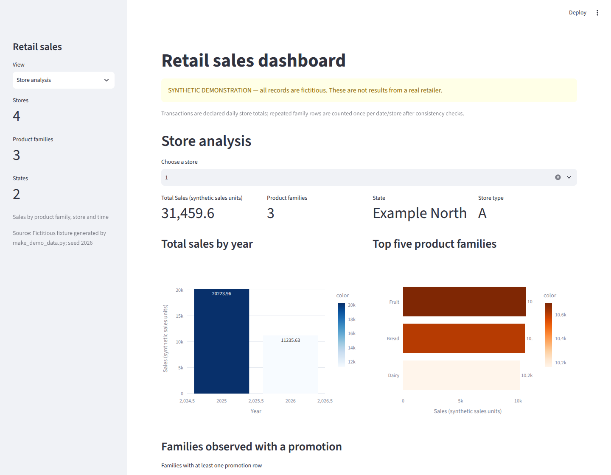

# Retail sales dashboard

An interactive Streamlit and Plotly dashboard to explore retail sales
by product family, shop, state and time. It also compares promotion groups and
daily sales with an oil-price series. The application starts with a clearly
labelled **synthetic example**; no displayed figure describes a real retailer.



Existing application screenshot synchronised from the project collection.
Select **Store analysis → store 1** with the bundled fixture to reproduce the
displayed view: 31,459.6 synthetic sales units across three product families.

**Technical focus:** explicit data contracts, transaction-grain checks, missing
periods and careful comparisons across four interactive views. Built with
Python, pandas, Streamlit, Plotly and statsmodels.

## Run

Python 3.12; tested with 3.12.14. From this folder:

```bash
python -m venv .venv
source .venv/bin/activate
python -m pip install -r requirements.txt
python -m streamlit run app.py
```

On Windows, activate with `.venv\Scripts\activate`. Open the local URL printed
by Streamlit. No account or data download is required. `statsmodels` is included
because the exploratory view uses Plotly's OLS trend line.

The fixture contains 1,116 fictitious rows: four shops, three product families
and 93 observed dates across January/March 2025 and January 2026. It intentionally
omits most months and some oil observations. Regenerate it with
`python make_demo_data.py`; this replaces the bundled synthetic files.

## Four views

1. **Global overview:** store/family/state counts, rankings, promotion rows and
   weekday/week/month mean sales. Means are per observed store–family–day row,
   not total company sales per day.
2. **Store analysis:** yearly sales, leading families and families appearing on
   promotion rows for a selected shop.
3. **State analysis:** store rankings, family sales and annual transaction totals
   where transaction grain is documented.
4. **Exploratory insights:** promotion-group comparisons, monthly totals,
   same-month changes, a year/month heatmap, store types and a daily sales/oil
   scatter with an OLS line where defined.

The available output is the runnable synthetic dashboard, not reproduced
real-company KPIs. All four views were exercised with Streamlit AppTest; the
actual local server returned HTTP 200 for its health endpoint and root page.
The existing screenshot shows the desktop interface; browser rendering,
responsive layouts and live browser interaction were not re-tested in this
review. Automated AppTest coverage exercises all four views and their selectors.

## Tests

```bash
python -m unittest discover -s tests -v
```

Eight tests cover schema and unique keys, transaction grain, missing months,
complete same-month comparisons, all four AppTest views and selector changes,
zero/constant/missing data and absent inputs. They inspect Plotly specifications
and exercise the OLS branch. AppTest does not check browser appearance or live
WebSocket interaction.

## Use your own authorised data

Replace these placeholder paths with existing local files:

```bash
RETAIL_DATA_PATH=/path/to/authorised_sales.csv \
RETAIL_METADATA_PATH=/path/to/metadata.json \
python -m streamlit run app.py
```

[data/README.md](data/README.md) defines the schema and metadata. The loader checks
daily dates, numeric values, store mappings and unique `date/store/family` keys.
`family` means product family, not SKU. Units come from metadata; no currency is
assumed. Transaction totals require an explicit daily-store or additive-row grain;
otherwise they remain hidden.

Missing months stay missing. Percentage comparisons require matching calendar
months, full observed daily coverage, matching store/family pairs and a positive
baseline. Those conditions do not establish complete capture of actual sales.
Promotion and oil comparisons are descriptive associations, without causal or
forecasting claims. Sales on promotion rows need not be sales of promoted items
alone. The original remote CSVs are absent; their source, licence, units and
transaction grain remain unresolved.

## Academic context and credit

Individual Data Visualisation final project, iMAT,
ICAI, Universidad Pontificia Comillas, 2026. Streamlit supplies the interface,
Plotly the charts and statsmodels the OLS fitting.

Post-submission corrections added explicit data/grain checks, handled empty
selectors and missing periods, and prevented oil traces from joining gaps. The
four views remain those of the coursework project.
