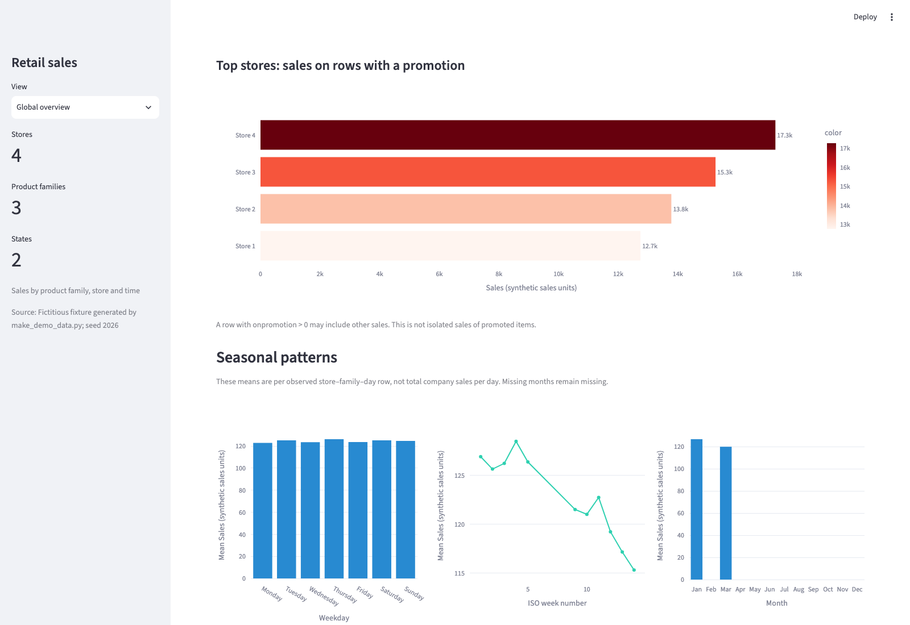
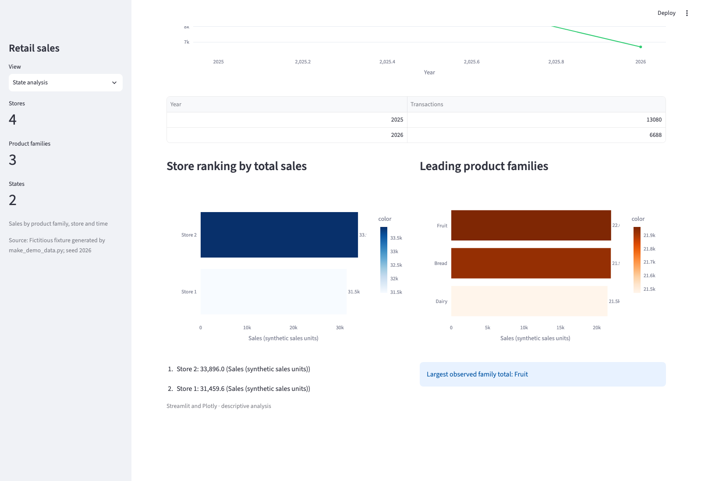

# Dashboard views

These are browser screenshots from the application running on macOS on
26 October 2026 with the bundled synthetic CSV and metadata. The run used
Python 3.12.2, Streamlit 1.66.1, Plotly 7.1.0 and Chromium 156.0.8078.4 at
1600 × 1100 pixels. All figures describe fictitious records.

The [README](../README.md) shows Store analysis and Exploratory insights. The
two views below add the promotion and seasonal summaries and the state-level
transaction aggregation.

## Global overview



The visible lower section shows sales on rows with a promotion and seasonal
means. These are means per observed store–family–day row, not total daily
company sales. Missing months remain blank. Sales on a promotion row need not
be sales of promoted items alone.

## State analysis



**State analysis → Example North**, lower visible section. The transaction table
uses the declared daily-store grain, so repeated family rows count once per
store and date. Year labels refer only to observed dates, not complete years.
The table reports 13,080 transactions in the included 2025 dates and 6,688 in
the included 2026 dates.

## Reproduce the views

After following the installation steps in the README, run this command from
the project folder on macOS or Linux to select the same bundled inputs:

```bash
RETAIL_DATA_PATH=data/synthetic_sales.csv \
RETAIL_METADATA_PATH=data/synthetic_metadata.json \
python -m streamlit run app.py --browser.gatherUsageStats=false
```

Open the local URL in a desktop browser. Use the **View** selector to visit
Global overview, Store analysis, State analysis and Exploratory insights. For
Store analysis select **1**; for State analysis select **Example North**.
Allow the charts to appear, then scroll to the section you want to capture.
The screenshots use a 1600 × 1100 viewport with the sidebar open; browser fonts
and versions may change the exact layout.

The recorded browser run selected these views and checked rendered Plotly
marks, the synthetic-data notice and the absence of application/browser errors.
It found six charts in Global overview, two in Store analysis, three in State
analysis and five in Exploratory insights. These screenshots preserve the
visible scroll position rather than the whole scrollable page. Some end labels
on horizontal bars are clipped by their chart areas; axes and explanatory text
remain visible. Some year axes use continuous scales and show fractional tick
labels between the observed integer years; those ticks are chart positions,
not additional reporting periods. No labels, values or layout were edited in
the image files.

The earlier `images/store-analysis.png` remains the historical screenshot
supplied with the project. It is separate from these new captures.
